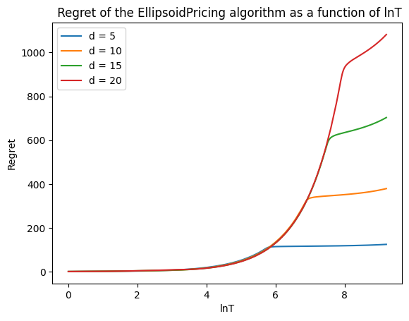
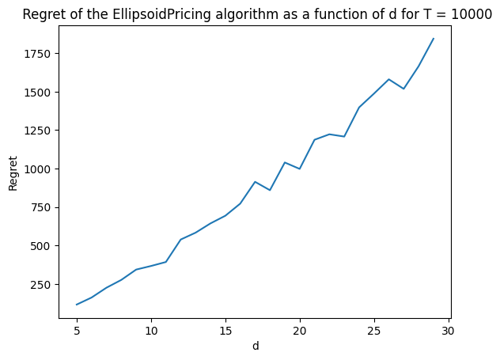
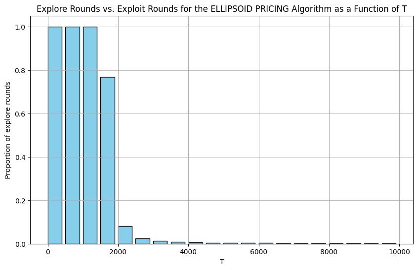
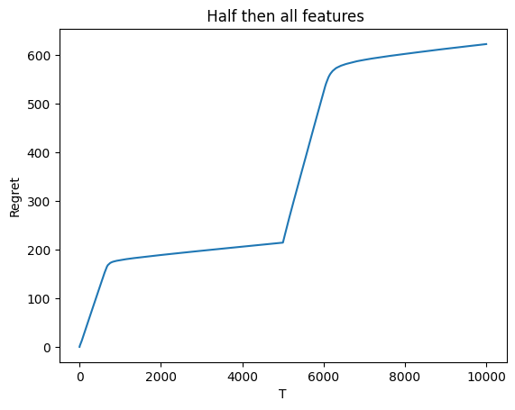

# Feature-Based Dynamic Pricing: Implementation of Cohen, Lobel & Paes Leme (2020)

From-scratch Python implementation of the contextual pricing algorithms in M. C. Cohen, I. Lobel and R. Paes Leme, *Feature-Based Dynamic Pricing*, [Management Science 66(11), 4921–4943 (2020)](https://doi.org/10.1287/mnsc.2019.3485), with a reproduction of the paper's numerical experiments.

Course project for AID-554, IIT Roorkee, by Pratyush Jha and Sudatt Kayal. Slides: [AID554_Project_Presentation.pdf](AID554_Project_Presentation.pdf).

## Problem

A seller prices a stream of differentiated products. In each round t:

1. Nature, possibly adversarially, reveals a feature vector x_t ∈ ℝ^d of the product.
2. The buyer's valuation is v_t = θᵀx_t (+ noise δ_t), where θ is unknown to the seller.
3. The seller posts a price p_t and observes only whether the product sells (p_t ≤ v_t).

The seller earns p_t on a sale and nothing otherwise. Performance is measured by the regret, Σ_t (v_t − p_t · 1{p_t ≤ v_t}).

## Algorithms

| Algorithm | Setting | Regret bound (paper) | Notebook |
|---|---|---|---|
| EllipsoidPricing | Noiseless | O(R d² ln(T/d)) | `EllipsoidPricing_ShallowPricing.ipynb` |
| ShallowPricing | Low noise, σ = O(1/(T ln T)) | O(R d² ln(T/d)) | `EllipsoidPricing_ShallowPricing.ipynb` |
| EXP4 (benchmark) | Noiseless | Õ(d^{1/3} T^{2/3}) | `EXP4_v2.ipynb` |

- **EllipsoidPricing** is a multidimensional binary search. It keeps an ellipsoid of candidate θ. If the range of possible values of θᵀx_t is wider than ε = Rd²/T, it explores: it posts the midpoint price, cuts the ellipsoid through its centre, and replaces the remaining half by its Löwner–John ellipsoid. Otherwise it exploits by posting the lowest possible value.
- **ShallowPricing** handles sub-Gaussian noise with a buffer δ̄ = √2 σ ln T: it makes shallow cuts that keep more than half of the ellipsoid, and lowers exploit prices by δ̄.
- **EXP4** is the contextual-bandit benchmark used in the paper. Each policy corresponds to a θ on a grid of spacing γ over [0, 1]^d and posts the price ⌊θᵀx_t⌋_{γ√d} − γ√d. Policy weights are updated by exponential weighting of importance-weighted reward estimates.

The main loops are compiled with Numba.

## Results: EllipsoidPricing

The experiments follow Section 8 of the paper: θ and x_t are drawn from |N(0, I)| and normalized to unit norm, R = 1, T = 10,000, and results are averaged over 100 instances.

- Regret grows during an initial exploration phase and then flattens, consistent with regret logarithmic in T.
- Regret at T = 10,000 grows roughly linearly with d (d = 5 to 29).
- For d = 15, almost all exploration happens in the first ~2,000 rounds.
- When half of the features are zero until T/2 and then become active, the algorithm returns to exploration, and its regret flattens again.

The qualitative behaviour matches the paper's figures; the absolute values of regret are lower than in the paper. The presentation places each figure next to the corresponding one from the paper.

| Regret vs ln T | Regret vs d (T = 10,000) |
|---|---|
|  |  |

| Explore rounds (d = 15) | Half, then all features active (d = 15) |
|---|---|
|  |  |

## Running

Open any notebook in Google Colab (badge at the top of each notebook), or run it locally with `numpy`, `matplotlib` and `numba`.
